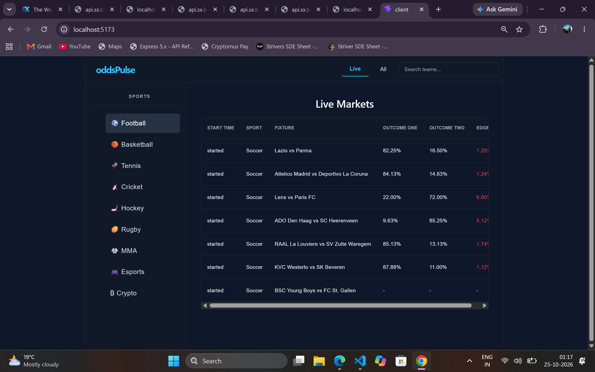
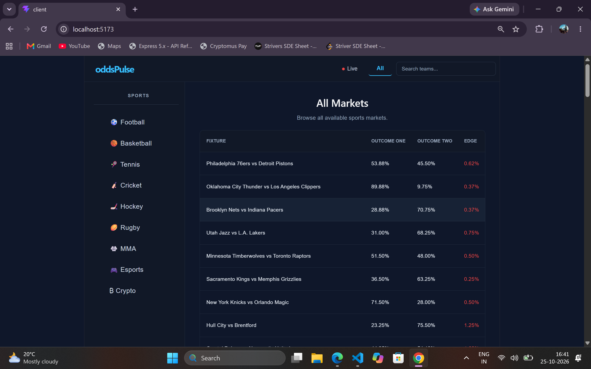
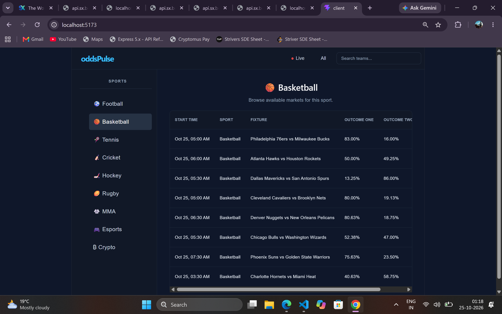
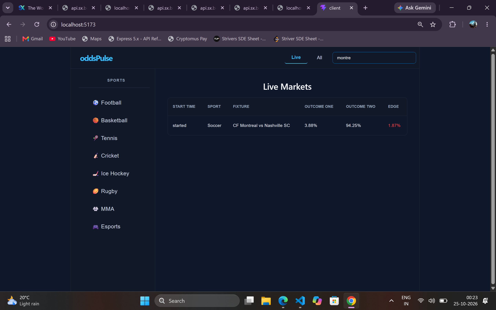
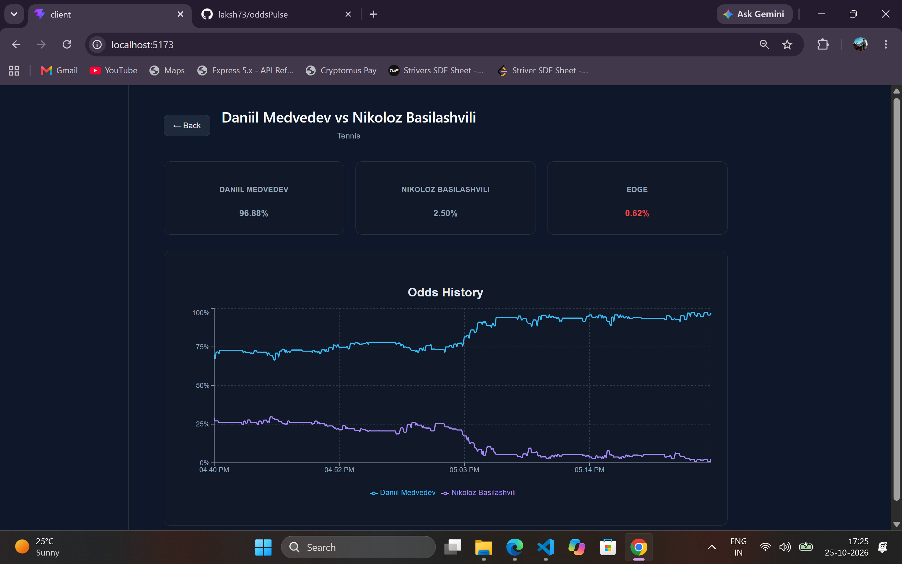

# oddsPulse — Real-Time Sports Odds Tracking & Edge Calculation Platform

oddsPulse is a full-stack web application that tracks sports markets, displays outcome probabilities, and visualizes historical odds movements using the SX Bet API.

## Features

- **Live Markets:** View live sports markets and their odds.
- **All Markets:** Browse available sports markets.
- **Sport Filtering:** Filter markets by sport.
- **Match Search:** Find fixtures using team names.
- **Match Details:** View outcome probabilities and calculated market edge.
- **Historical Odds Charts:** Visualize odds movements over time.
- **Real-Time Data:** Receive odds updates through WebSockets.
- **Historical Data Storage:** Store odds snapshots in MongoDB.


## Screenshots

### Live Markets
View live sports markets and their current odds.



### All Markets
Browse available markets across supported sports.



### Sport Filtering
Filter the markets by sport to find relevant matches.



### Search Matches
Search for Mathces by team names.



### Historical Odds Chart
Visualize how outcome probabilities change over time.



## Tech Stack

- **Frontend:** React, Vite, Recharts
- **Backend:** Node.js, Express.js
- **Database:** MongoDB, Mongoose
- **API & Real-Time Data:** SX Bet API, WebSockets

## How It Works

1. The backend retrieves sports market information from the SX Bet API.
2. A WebSocket connection receives odds updates for subscribed markets.
3. Odds snapshots are stored in MongoDB for historical tracking.
4. The backend exposes REST API endpoints for market data and odds history.
5. The React frontend displays markets, match details, current odds, and historical charts.

## Project Structure

```text
oddsPulse/
├── client/    # React frontend
├── server/    # Express backend and odds processing
└── README.md
```

## Purpose

This project demonstrates full-stack development, API integration, real-time data processing, database persistence, and interactive data visualization.

---

**Note:** oddsPulse uses the SX Bet API as its sports market data source.